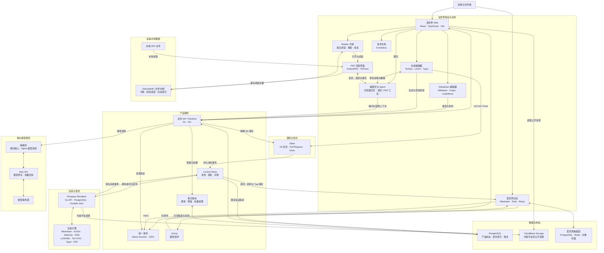

# 芥子环

[简体中文](README.md) | [English](README_EN.md)

芥子环是一个以标签连接文章、书籍与社区的知识平台，支持 Markdown、LaTeX 和 Typst 创作，以 Git 保留内容源码与修订历史。

[官网](https://rinspace.com) · [在线编辑器](https://rinspace.com/editor/) · [PDF 阅读器](https://rinspace.com/reader) · [技术文档](https://rinspace.com/docs/)

## 创作与阅读

- **文章与书籍**：多格式写作、渲染与发布，呈现公式、代码、图表和参考文献。
- **标签与社区**：通过标签关系组织知识，连接内容、作者与讨论。
- **在线编辑器**：本地工作区、账号项目与 Git 协作，琳可辅助阅读和修改项目文件。
- **PDF 阅读器**：打开本地 PDF，使用最近阅读与书架管理记录，保存阅读进度并续读。
- **琳**：聊天、辅助写作与 PDF 问答；阅读时可识别当前页、解释选区，并通过页码引用返回原文。

## 开源项目

| 项目 | 内容 |
| --- | --- |
| [rinspace-web](https://github.com/rinspacehq/rinspace-web) | 主站前端、Reader 书架与浏览器集成 |
| [rinspace-renderer](https://github.com/rinspacehq/rinspace-renderer) | Markdown、LaTeX、Typst 与图表渲染 |
| [rinspace-editor-markdown](https://github.com/rinspacehq/rinspace-editor-markdown) | 基于 Milkdown / Crepe 的 Markdown 编辑器 |
| [rinspace-tags](https://github.com/rinspacehq/rinspace-tags) | 标签关系、稳定身份与生命周期内核 |
| [rinspace-rin](https://github.com/rinspacehq/rinspace-rin) | 琳的聊天核心与 Agent 模型调用协议 |
| [rinspace-docs](https://github.com/rinspacehq/rinspace-docs) | 基于 Fumadocs 的技术文档站 |

## 上游分支

| 项目 | 内容 |
| --- | --- |
| [texlyre](https://github.com/rinspacehq/texlyre) | LaTeX / Typst 在线编辑器、本地工作区与账号项目 |
| [embed-pdf-viewer](https://github.com/rinspacehq/embed-pdf-viewer) | EmbedPDF 阅读器与原生琳插件 |
| [gitea](https://github.com/rinspacehq/gitea) | 内容源码、Git 历史与协作 |
| [mastodon](https://github.com/rinspacehq/mastodon) | 里世界社区 |
| [new-api](https://github.com/rinspacehq/new-api) | 模型网关与调用计量 |
| [cline](https://github.com/rinspacehq/cline) | 编码 Agent 与工具调用集成 |

## 架构概览

| 设计原则 | 实现方式 |
| --- | --- |
| 源码可追溯 | 长文以 Gitea 中的 Git 提交为权威源码，协作保留 Pull Request、Issue 和完整历史。 |
| 发布不可变 | 发布绑定精确提交和制品摘要；新版本验证失败时继续提供上一成功版本。 |
| 职责分离 | 产品服务负责业务与身份，Control Plane 负责编排，Renderer 通过独立引擎生成结果。 |
| 两个世界、一个身份 | 表世界承载知识内容，里世界承载本地社区；二者以稳定主体和 OIDC 连接。 |
| 明确事实来源 | Gitea 保存长文源码，Mastodon 保存社交关系与推文，Gorse 只对候选内容排序。 |
| 本地阅读 | PDF 在设备上打开，书架与进度保存在 IndexedDB；文件句柄用于重新访问原文件。 |
| 琳的职责 | 浏览器执行项目与 PDF 工具；业务服务统一鉴权和计费，琳服务通过模型网关获取回答与用量。 |

## 社区贡献

| 贡献者 | 项目 | 已采纳内容 |
| --- | --- | --- |
| [@xjn2005](https://github.com/xjn2005) | [rinspace-web #25](https://github.com/rinspacehq/rinspace-web/pull/25) | 个人资料页布局、深色模式简介、个人网站链接与测试 |
| [@xjn2005](https://github.com/xjn2005) | [rinspace-editor-markdown #13](https://github.com/rinspacehq/rinspace-editor-markdown/pull/13) | VS Code 源码粘贴为代码块、演示图片与依赖更新 |

欢迎在各项目提交 Issue 和 Pull Request；跨项目建议可在[这里](https://github.com/rinspacehq/.github/issues)讨论。

## 致谢

感谢这些开源项目的维护者与贡献者。

| 领域 | 开源项目 |
| --- | --- |
| 社区与协作 | [`Git`](https://git-scm.com/) · [`Gitea`](https://github.com/go-gitea/gitea) · [`Mastodon`](https://github.com/mastodon/mastodon) · [`Gorse`](https://github.com/gorse-io/gorse) |
| Web 基础 | [`React`](https://github.com/facebook/react) · [`React Router`](https://github.com/remix-run/react-router) · [`TypeScript`](https://github.com/microsoft/TypeScript) · [`Vite`](https://github.com/vitejs/vite) · [`Tailwind CSS`](https://github.com/tailwindlabs/tailwindcss) · [`i18next`](https://github.com/i18next/i18next) · [`SWR`](https://github.com/vercel/swr) · [`Zustand`](https://github.com/pmndrs/zustand) |
| 界面与交互 | [`Animate UI`](https://github.com/imskyleen/animate-ui) · [`Radix Primitives`](https://github.com/radix-ui/primitives) · [`Motion`](https://github.com/motiondivision/motion) · [`Lucide`](https://github.com/lucide-icons/lucide) · [`Bootstrap Icons`](https://github.com/twbs/icons) · [`Phosphor Icons`](https://github.com/phosphor-icons/core) |
| 写作与编辑 | [`TeXlyre`](https://github.com/TeXlyre/texlyre) · [`Milkdown`](https://github.com/Milkdown/milkdown) / Crepe · [`ProseMirror`](https://github.com/ProseMirror/prosemirror) · [`CodeMirror`](https://github.com/codemirror/dev) · [`Yjs`](https://github.com/yjs/yjs) · [`isomorphic-git`](https://github.com/isomorphic-git/isomorphic-git) |
| 内容与渲染 | [`unified`](https://github.com/unifiedjs/unified) · [`remark`](https://github.com/remarkjs/remark) · [`rehype`](https://github.com/rehypejs/rehype) · [`KaTeX`](https://github.com/KaTeX/KaTeX) · [`MathJax`](https://github.com/mathjax/MathJax-src) · [`Shiki`](https://github.com/shikijs/shiki) |
| 排版与文档 | [`Typst`](https://github.com/typst/typst) · [`LaTeXML`](https://github.com/brucemiller/LaTeXML) · [`TeX Live`](https://tug.org/texlive/) · [`dvisvgm`](https://github.com/mgieseki/dvisvgm) · [`PDF.js`](https://github.com/mozilla/pdf.js) |
| 服务与数据 | [`Go`](https://github.com/golang/go) · [`Gin`](https://github.com/gin-gonic/gin) · [`Node.js`](https://github.com/nodejs/node) · [`Ruby on Rails`](https://github.com/rails/rails) · [`Sidekiq`](https://github.com/sidekiq/sidekiq) · [`PostgreSQL`](https://github.com/postgres/postgres) · [`Redis`](https://github.com/redis/redis) · [`CloudBase JavaScript SDK`](https://github.com/TencentCloudBase/cloudbase-js-sdk) |
| 工程质量与文档 | [`Playwright`](https://github.com/microsoft/playwright) · [`Vitest`](https://github.com/vitest-dev/vitest) · [`Testing Library`](https://github.com/testing-library) · [`axe-core`](https://github.com/dequelabs/axe-core) · [`Mermaid`](https://github.com/mermaid-js/mermaid) · [`Fumadocs`](https://github.com/fuma-nama/fumadocs) |
| 字体 | [`Noto Sans SC`](https://github.com/google/fonts/tree/main/ofl/notosanssc) · [`IBM Plex`](https://github.com/IBM/plex) · [`Newsreader`](https://github.com/productiontype/Newsreader) · [`Fira Code`](https://github.com/tonsky/FiraCode) · [`JetBrains Mono`](https://github.com/JetBrains/JetBrainsMono) · [`WenQuanYi Zen Hei`](https://sourceforge.net/projects/wqy/files/wqy-zenhei/) |
| PDF 阅读 | [EmbedPDF](https://github.com/embedpdf/embed-pdf-viewer) · [PDFium](https://pdfium.googlesource.com/pdfium/) |
| AI 与 Agent | [Cline](https://github.com/cline/cline) · [New API](https://github.com/QuantumNous/new-api) |

---

最后更新：2026-11-01
