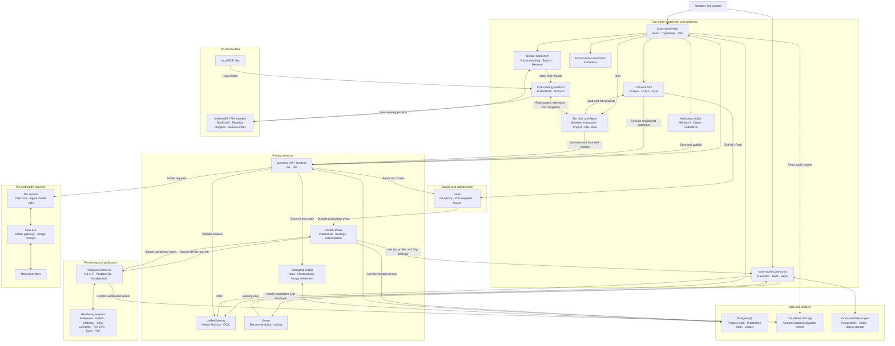

# Rinspace

[简体中文](README.md) | [English](README_EN.md)

Rinspace connects articles, books, and communities through tags. It supports Markdown, LaTeX, and Typst authoring, with source files and revision history preserved in Git.

[Website](https://rinspace.com) · [Online editor](https://rinspace.com/editor/) · [PDF reader](https://rinspace.com/reader) · [Documentation](https://rinspace.com/docs/)

## Create and read

- **Articles and books**: write, render, and publish documents with equations, code, diagrams, and references.
- **Tags and community**: organize knowledge through tag relationships and connect content, authors, and discussions.
- **Online editor**: local workspaces, account projects, and Git collaboration, with Rin assisting in reading and editing project files.
- **PDF reader**: open local PDFs, manage recent reading and a bookshelf, and resume from your saved position.
- **Rin**: chat, writing assistance, and PDF questions. Rin can identify the current page, explain selections, and cite pages that link back to the document.

## Open-source projects

| Project | Focus |
| --- | --- |
| [rinspace-web](https://github.com/rinspacehq/rinspace-web) | Main website, Reader bookshelf, and browser integrations |
| [rinspace-renderer](https://github.com/rinspacehq/rinspace-renderer) | Markdown, LaTeX, Typst, and diagram rendering |
| [rinspace-editor-markdown](https://github.com/rinspacehq/rinspace-editor-markdown) | Markdown editor built with Milkdown / Crepe |
| [rinspace-tags](https://github.com/rinspacehq/rinspace-tags) | Tag relationships, stable identities, and lifecycle kernel |
| [rinspace-rin](https://github.com/rinspacehq/rinspace-rin) | Rin chat core and Agent model-call protocol |
| [rinspace-docs](https://github.com/rinspacehq/rinspace-docs) | Technical documentation built with Fumadocs |

## Upstream forks

| Project | Focus |
| --- | --- |
| [texlyre](https://github.com/rinspacehq/texlyre) | LaTeX / Typst online editor, local workspaces, and account projects |
| [embed-pdf-viewer](https://github.com/rinspacehq/embed-pdf-viewer) | EmbedPDF viewer and native Rin plugin |
| [gitea](https://github.com/rinspacehq/gitea) | Content source, Git history, and collaboration |
| [mastodon](https://github.com/rinspacehq/mastodon) | Inner-world community |
| [new-api](https://github.com/rinspacehq/new-api) | Model gateway and usage metering |
| [cline](https://github.com/rinspacehq/cline) | Coding Agent and tool-call integration |

## Architecture

| Design principle | Implementation |
| --- | --- |
| Traceable source | Long-form content uses Git commits in Gitea as its authoritative source, retaining Pull Requests, Issues, and complete history. |
| Immutable publication | A publication is bound to an exact commit and artifact digest. A failed candidate leaves the previous successful version active. |
| Separation of responsibilities | Product services own business and identity concerns, the Control Plane orchestrates work, and the Renderer produces results through isolated engines. |
| Two worlds, one identity | The outer world presents knowledge, while the inner world hosts the local community; stable subjects and OIDC connect them. |
| Explicit sources of truth | Gitea owns long-form source, Mastodon owns social relationships and posts, and Gorse ranks candidates without owning them. |
| Local reading | PDFs open on the device; IndexedDB stores the bookshelf and progress, and file handles provide access to the original files. |
| Rin responsibilities | The browser executes project and PDF tools. Product services handle identity and billing; Rin calls the model gateway for answers and usage. |

## Community contributions

| Contributor | Project | Merged contributions |
| --- | --- | --- |
| [@xjn2005](https://github.com/xjn2005) | [rinspace-web #25](https://github.com/rinspacehq/rinspace-web/pull/25) | Profile layout, dark-mode biography, personal website links, and tests |
| [@xjn2005](https://github.com/xjn2005) | [rinspace-editor-markdown #13](https://github.com/rinspacehq/rinspace-editor-markdown/pull/13) | Paste VS Code source as code blocks, demo images, and dependency updates |

Issues and pull requests are welcome in each repository. Discuss cross-project ideas [here](https://github.com/rinspacehq/.github/issues).

## Acknowledgements

Thanks to the maintainers and contributors of these open-source projects.

| Area | Open-source projects |
| --- | --- |
| Community and collaboration | [`Git`](https://git-scm.com/) · [`Gitea`](https://github.com/go-gitea/gitea) · [`Mastodon`](https://github.com/mastodon/mastodon) · [`Gorse`](https://github.com/gorse-io/gorse) |
| Web foundations | [`React`](https://github.com/facebook/react) · [`React Router`](https://github.com/remix-run/react-router) · [`TypeScript`](https://github.com/microsoft/TypeScript) · [`Vite`](https://github.com/vitejs/vite) · [`Tailwind CSS`](https://github.com/tailwindlabs/tailwindcss) · [`i18next`](https://github.com/i18next/i18next) · [`SWR`](https://github.com/vercel/swr) · [`Zustand`](https://github.com/pmndrs/zustand) |
| Interface and interaction | [`Animate UI`](https://github.com/imskyleen/animate-ui) · [`Radix Primitives`](https://github.com/radix-ui/primitives) · [`Motion`](https://github.com/motiondivision/motion) · [`Lucide`](https://github.com/lucide-icons/lucide) · [`Bootstrap Icons`](https://github.com/twbs/icons) · [`Phosphor Icons`](https://github.com/phosphor-icons/core) |
| Authoring and editing | [`TeXlyre`](https://github.com/TeXlyre/texlyre) · [`Milkdown`](https://github.com/Milkdown/milkdown) / Crepe · [`ProseMirror`](https://github.com/ProseMirror/prosemirror) · [`CodeMirror`](https://github.com/codemirror/dev) · [`Yjs`](https://github.com/yjs/yjs) · [`isomorphic-git`](https://github.com/isomorphic-git/isomorphic-git) |
| Content and rendering | [`unified`](https://github.com/unifiedjs/unified) · [`remark`](https://github.com/remarkjs/remark) · [`rehype`](https://github.com/rehypejs/rehype) · [`KaTeX`](https://github.com/KaTeX/KaTeX) · [`MathJax`](https://github.com/mathjax/MathJax-src) · [`Shiki`](https://github.com/shikijs/shiki) |
| Typesetting and documents | [`Typst`](https://github.com/typst/typst) · [`LaTeXML`](https://github.com/brucemiller/LaTeXML) · [`TeX Live`](https://tug.org/texlive/) · [`dvisvgm`](https://github.com/mgieseki/dvisvgm) · [`PDF.js`](https://github.com/mozilla/pdf.js) |
| Services and data | [`Go`](https://github.com/golang/go) · [`Gin`](https://github.com/gin-gonic/gin) · [`Node.js`](https://github.com/nodejs/node) · [`Ruby on Rails`](https://github.com/rails/rails) · [`Sidekiq`](https://github.com/sidekiq/sidekiq) · [`PostgreSQL`](https://github.com/postgres/postgres) · [`Redis`](https://github.com/redis/redis) · [`CloudBase JavaScript SDK`](https://github.com/TencentCloudBase/cloudbase-js-sdk) |
| Engineering quality and documentation | [`Playwright`](https://github.com/microsoft/playwright) · [`Vitest`](https://github.com/vitest-dev/vitest) · [`Testing Library`](https://github.com/testing-library) · [`axe-core`](https://github.com/dequelabs/axe-core) · [`Mermaid`](https://github.com/mermaid-js/mermaid) · [`Fumadocs`](https://github.com/fuma-nama/fumadocs) |
| Typefaces | [`Noto Sans SC`](https://github.com/google/fonts/tree/main/ofl/notosanssc) · [`IBM Plex`](https://github.com/IBM/plex) · [`Newsreader`](https://github.com/productiontype/Newsreader) · [`Fira Code`](https://github.com/tonsky/FiraCode) · [`JetBrains Mono`](https://github.com/JetBrains/JetBrainsMono) · [`WenQuanYi Zen Hei`](https://sourceforge.net/projects/wqy/files/wqy-zenhei/) |
| PDF reading | [EmbedPDF](https://github.com/embedpdf/embed-pdf-viewer) · [PDFium](https://pdfium.googlesource.com/pdfium/) |
| AI and Agents | [Cline](https://github.com/cline/cline) · [New API](https://github.com/QuantumNous/new-api) |

---

Last updated: 2026-11-01
